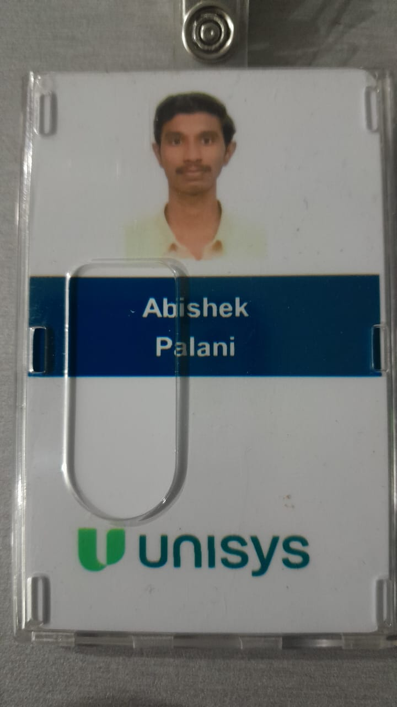

<!-- ======================================================== -->
<!-- 🛸 HERO HEADER WITH GLOWING CYBER EFFECT                 -->
<!-- ======================================================== -->

 

<!-- ======================================================== -->
<!-- 🪪 EXECUTIVE ENGINEER IDENTITY BADGE (PHOTO + TELEMETRY) -->
<!-- ======================================================== -->
<table align="center" width="100%" style="background-color: #0b0f19; border: 1px solid #1e293b; border-radius: 16px;">
  <tr>
    <!-- PHOTO COLUMN -->
    <td width="30%" align="center" valign="middle" style="padding: 24px;">
      
        
      
    </td>

    <!-- IDENTITY & TELEMETRY COLUMN -->
    <td width="70%" valign="middle" style="padding: 24px 28px;">
      <h2>⚡ ABISHEK PALANI S.</h2>
      

        
        
      

      
      

        
      

      <table width="100%" style="font-size: 13.5px;">
        <tr>
          <td><b>🏛️ Enterprise:</b></td>
          <td>Unisys India</td>
          <td><b>📍 Location:</b></td>
          <td>India (Global Hybrid)</td>
        </tr>
        <tr>
          <td><b>🧠 AI Core:</b></td>
          <td>MCP, Gemini 3.8, Llama-3 70B</td>
          <td><b>🔐 Crypto Core:</b></td>
          <td>Kyber-1024, NTRU, AES-256</td>
        </tr>
        <tr>
          <td><b>🌐 Stacks:</b></td>
          <td>Python, C#, Flutter, React, Next.js</td>
          <td><b>⚡ Engine:</b></td>
          <td>FastAPI, WebGL 3D, Supabase</td>
        </tr>
      </table>
    </td>
  </tr>
</table>

 

<!-- ======================================================== -->
<!-- 🏆 GITHUB PROFILE TROPHIES                                -->
<!-- ======================================================== -->

  

<!-- ======================================================== -->
<!-- 🔗 FLOATING INTERACTIVE CONNECT BUTTONS                  -->
<!-- ======================================================== -->

  
  &nbsp;&nbsp;
  
  &nbsp;&nbsp;
  
  &nbsp;&nbsp;
  

---

## 🏆 S-Rank Production Laboratories & Research

<table>
  <!-- ROW 1 -->
  <tr>
    <td width="50%" valign="top">
      

        
      

       
      

        <b>Autonomous Behavioral Anti-Ransomware Framework</b>: Intercepts active encryption attacks in <b>&lt;1.5 seconds</b> using Shannon entropy telemetry and a <b>QIBF + LSTM cascade voting engine</b>. Surgically isolates target directories into POSIX <code>0o444</code> read-only mode and triggers granular <b>AES-256 cloud key rotation</b> with zero server-wide downtime.
      

      

        
        
        
        
      

    </td>
    <td width="50%" valign="top">
      

        
      

       
      

        <b>Fintech &amp; UPI 2.0 Ecosystem with Autonomous Financial AI Guardrails</b>: Complete mobile banking architecture with 30+ Flutter screens and FastAPI backend. Features <b>Event Collect</b> (non-custodial direct-to-bank group fundraising with verifiable <b>ECDSA SHA-256 proofs</b>), <b>RBI Account Aggregator</b> multi-bank consent syncing, and <b>PayGo AI (Llama-3 70B)</b> with deterministic spending guardrails.
      

      

        
        
        
        
      

    </td>
  </tr>

  <!-- ROW 2 -->
  <tr>
    <td width="50%" valign="top">
      

        
      

       
      

        <b>Post-Quantum Cryptographic Real-Time Voice Platform</b>: Neutralizes quantum adversaries and AI vocal biometric profiling. Integrates NIST standardized <b>ML-KEM (CRYSTALS-Kyber-1024)</b> lattice key encapsulation for peer-to-peer WebRTC calls, coupled with a real-time <b>FFT band-shift acoustic obfuscation DSP engine</b> degrading speaker recognition models by &gt;92%.
      

      

        
        
        
        
      

    </td>
    <td width="50%" valign="top">
      

        
      

       
      

        <b>AI-Assisted Environmental Intelligence &amp; Satellite Change Analysis</b>: Connects Copernicus Sentinel-2 L2A satellite observations with traceable, reviewable environmental investigations. Employs multi-spectral NDVI geospatial verification and a strict <b>ProofLoop framework</b> powered by <b>Gemini 3.8 Flash</b> on Google Cloud Run.
      

      

        
        
        
        
      

    </td>
  </tr>

  <!-- ROW 3 -->
  <tr>
    <td width="50%" valign="top">
      

        
      

       
      

        <b>Autonomous Threat Intelligence &amp; Cyber Forensics Platform</b>: Performs automated OSINT reconnaissance across suspect identifiers, dark-web breach caches, and social footprints. Renders interactive <b>React Flow node-link relationship graphs</b>, builds chronological incident timelines, and compiles SHA-256 timestamped forensic dossiers.
      

      

        
        
        
        
      

    </td>
    <td width="50%" valign="top">
      

        
      

       
      

        <b>100% Offline-First Interactive 3D STEM Education Engine</b>: Brings visual, intelligent education to zero-internet environments. Executes quantized <b>Llama/Qwen GGUF models directly on-device</b> via <code>llama.cpp</code>, triggering embedded <b>Three.js stereoscopic Red-Cyan 3D WebGL scenes</b> and reactive vector character state-machines via Rive.
      

      

        
        
        
        
      

    </td>
  </tr>
</table>

---

## ⚡ Technical Arsenal & Cryptographic Capabilities

### 💻 Mastered Programming Paradigms

  

### 🧠 Autonomous AI, Agents & Model Context Protocol (MCP)

  
  
  
  
  
  

### 🔐 Advanced Cryptographic Primitives & Cyber Defense

  
  
  
  
  
  

### 🌐 Web, Cloud & Developer Infrastructure

  

---

## 🐍 Repository Contribution Matrix

---

## 💬 Initiate Transmission & Collaborate

  <i>Actively building next-generation systems across <b>Post-Quantum Cryptography</b>, <b>Autonomous AI &amp; Model Context Protocol (MCP)</b>, and <b>Enterprise Cyber Threat Mitigation</b>.</i>

 

&nbsp;&nbsp;

&nbsp;&nbsp;

  

